# Portfolio & CV DevSecOps — Ferid Saad (Next.js 15)

Ce projet est une réinterprétation moderne et interactive du CV de **Ferid Saad** (initialement réalisé en HTML/CSS/JS dans le cadre du TP1 Déploiement & CI/CD), entièrement reconstruite avec **Next.js 15**, **React 19**, **TypeScript** et un design system **Vanilla CSS** ultra-moderne avec mode sombre/clair, terminal interactif et conteneurisation Docker DevSecOps.

---

## 🌟 Points Forts & Fonctionnalités

- ⚡ **Next.js 15 & React 19 (App Router)** : Performance optimale, rendu hybride et architecture composable.
- 🎨 **Design Moderne & Glassmorphism** : Palette soignée inspirée du thème original (Cyan/Teal néon et ardoise sombre), typographies *Space Grotesk* et *Plus Jakarta Sans*.
- 🌓 **Mode Sombre / Clair Instantané** : Détection automatique des préférences système et mémorisation dans le `localStorage`.
- 💻 **Terminal DevSecOps Interactif** :
  - Simulation d'un shell Linux en ligne de commande.
  - Commandes disponibles : `whoami`, `skills`, `projects`, `docker run cv`, `contact`, `clear`.
  - Puces cliquables pour exécuter des commandes en un clic.
- 🗂️ **Filtrage Dynamique des Projets** : Catégories *DevSecOps & CI/CD*, *Robotique & IoT*, *Systèmes & Réseaux*, *Web & Bases de données*.
- ⏱️ **Parcours & Frise Chronologique** :
  - 24 ans d'expérience dans l'enseignement technique (2002 - 2026).
  - Diplômes (Licence ISET Tozeur 2025, CAPES 2002, Sup'Com 2001, Monastir 2000, Bac 1995).
  - Certifications (Robotique 2018, Windows Server & SQL Server 2001).
- 🖨️ **Impression & Export PDF Optimisé** : Feuilles de styles `@media print` dédiées pour générer un CV papier ou PDF net et épuré.
- 📬 **Formulaire de Contact & Copie Rapide** : Copie en un clic des coordonnées (téléphone, email) avec notification toast et animation de confettis.

---

## 🚀 Démarrage Rapide en Local

### Prérequis
- **Node.js** >= 18.x (testé sur v24.x)
- **npm** ou **yarn** / **pnpm**

### Installation et Lancement
```bash
# 1. Cloner la branche 'portfilio'
git clone -b portfilio https://github.com/ferid-saad/devsecops-portfolio.git
cd TP1-Dep-App-CI-CD

# 2. Installer les dépendances
npm install

# 3. Lancer le serveur de développement
npm run dev
```

Accédez à l'application dans votre navigateur sur [http://localhost:3000](http://localhost:3000).

### Build de Production
```bash
npm run build
npm run start
```

---

## 🐳 Déploiement Conteneurisé avec Docker

Conformément à la philosophie DevSecOps du TP1, le projet comprend un `Dockerfile` multi-stage sécurisé et optimisé pour Next.js (sortie `standalone`) et un fichier `docker-compose.yml`.

### Caractéristiques de Sécurité :
- **Image de base minimale** : Alpine Linux (`node:20-alpine`) pour minimiser la surface d'attaque.
- **Utilisateur non-privilégié** : Exécution sous l'utilisateur système `nextjs` (UID 1001), sans aucun privilège root.
- **Healthcheck actif** : `wget -qO- http://localhost:8080/ || exit 1` testé toutes les 30 secondes.
- **Option no-new-privileges** activée dans Compose.

### 1. Lancement via Docker Compose
```bash
docker compose up -d --build
```

Vérifiez le statut du conteneur :
```bash
docker compose ps
```

L'application est accessible sur [http://localhost:8081](http://localhost:8081).

### 2. Lancement manuel avec Docker CLI
```bash
# Construction de l'image
docker build -t portfolio-nextjs .

# Lancement du conteneur en arrière-plan sur le port 8081
docker run -d --name cv-nextjs -p 8081:8080 --restart unless-stopped portfolio-nextjs
```

---

## 📁 Architecture du Projet

```
TP1-Dep-App-CI-CD/
├── app/
│   ├── globals.css          # Design system, variables CSS, glassmorphism, responsive & print
│   ├── layout.tsx           # Layout racine, métadonnées SEO, script anti-flicker thème
│   └── page.tsx             # Page principale assemblant les composants
├── components/
│   ├── Navbar.tsx           # Barre de navigation, bascule de thème, impression
│   ├── Hero.tsx             # Carte profil, statistiques, actions rapides, copie directe
│   ├── DevSecOpsTerminal.tsx# Terminal shell interactif (commandes Docker, whoami, etc.)
│   ├── SkillsMatrix.tsx     # Matrice des compétences avec barres de progression
│   ├── ProjectsSection.tsx  # Galerie de projets avec filtres interactifs
│   ├── TimelineSection.tsx  # Frise chronologique (Expériences, Diplômes, Certifications)
│   ├── ContactSection.tsx   # Canaux de contact, formulaire interactif & confettis
│   └── Footer.tsx           # Pied de page avec badges technologiques
├── data/
│   └── cv-data.ts           # Modèle de données typé et centralisé du CV
├── public/
│   └── images/              # Photo de profil, captures et logos
├── Dockerfile               # Multi-stage build sécurisé (non-root, healthcheck)
├── docker-compose.yml       # Orchestration locale sur le port 8081
├── next.config.mjs          # Configuration Next.js (output standalone)
├── package.json             # Dépendances et scripts du projet
└── tsconfig.json            # Configuration TypeScript stricte
```
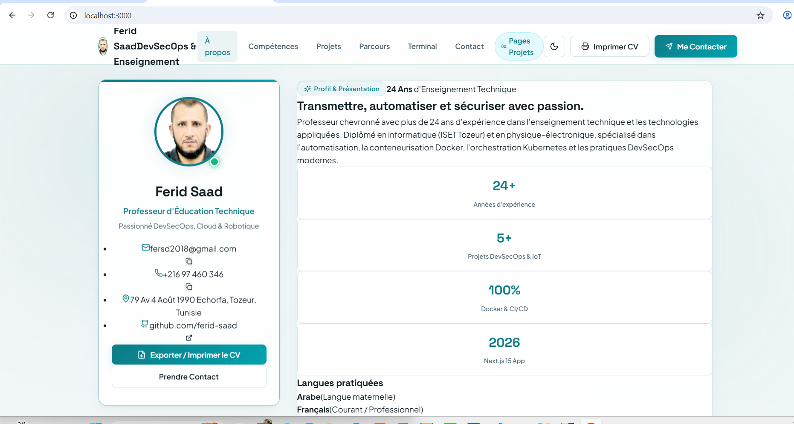
---

## 🔄 Intégration CI/CD (Jenkins & GitHub)

Ce projet est prêt pour être intégré dans un pipeline Jenkins CI/CD :
1. **Étape 1 : Checkout** : Récupération du code sur la branche `portfilio`.
2. **Étape 2 : Lint & Build** : `npm ci && npm run build`.
3. **Étape 3 : Docker Build** : `docker build -t cv-nextjs:${BUILD_NUMBER} .`.
4. **Étape 4 : Test & Healthcheck** : Lancement en environnement de test et validation de la réponse HTTP 200.
5. **Étape 5 : Déploiement** : Mise à jour du conteneur sur le serveur cible.

---
## VI. Premier pipeline Jenkins
Jenkinsfile
````
pipeline {
    agent any

    stages {
        stage('Checkout') {
            steps {
                checkout scm
            }
        }
    }
}
````

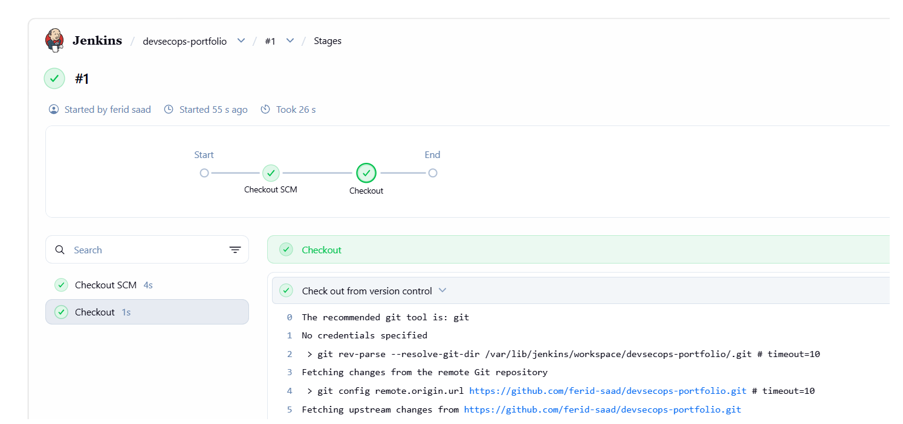

### 23- Ajoutez au pipeline une étape permettant d'installer les dépendances du projet Next.js.

Nouveau Jenkinsfile
````
pipeline {
    agent any

    stages {
        stage('Checkout') {
            steps {
                checkout scm
            }
        }

        stage('Install Dependencies') {
            steps {
                sh 'node -v'
                sh 'npm -v'
                sh 'npm ci'
            }
        }
    }
}
````
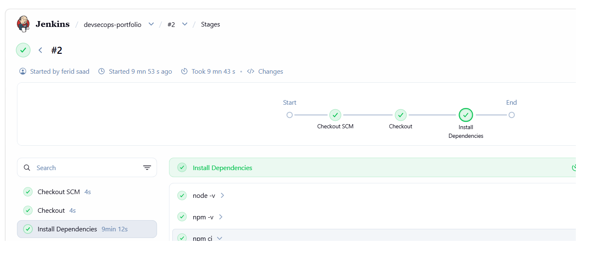


## Étape 24 : build de l'application

Ajout du stage `Build` :

```groovy
stage('Build') {
    steps {
        sh 'npm run build'
    }
}
```

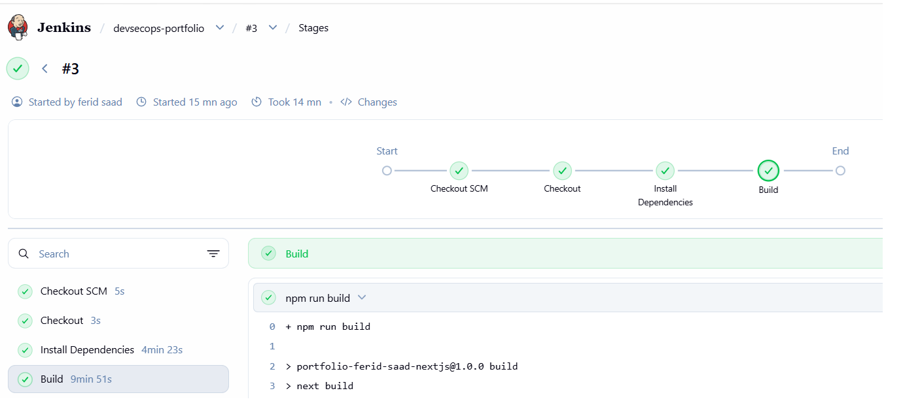

# Activité 3 : Ansible, API Express, variables d'environnement et Docker

## VII. Automatisation avec Ansible
---

# Activité 3 : Ansible, API Express, variables d'environnement et Docker

## VII. Automatisation avec Ansible

### Architecture

| Machine | Rôle | Adresse IP |
|---|---|---|
| `admin-ansible` | VM d'administration (nœud de contrôle, Ansible installé) | réseau 192.168.50.0/24 |
| `server-1` (webserver) | Serveur Ubuntu géré | 192.168.50.89 |
| `server-2` (ftpserver) | Serveur Ubuntu géré | 192.168.50.90 |

Ansible fonctionne sans agent : il est installé uniquement sur `admin-ansible` et se connecte aux serveurs en SSH.

### Étape 25 : installation d'Ansible sur la VM d'administration

```bash
sudo apt update
sudo apt install -y ansible-core
ansible --version
```

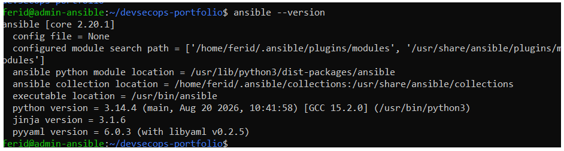

### Étape 26 : inventory et test de communication

**1. Authentification SSH par clé** (depuis `admin-ansible`) :

```bash
ssh-keygen -t ed25519 -C "ansible-admin"
ssh-copy-id ferid@192.168.50.89
ssh-copy-id ferid@192.168.50.90
ssh ferid@192.168.50.89 hostname
ssh ferid@192.168.50.90 hostname
```

La clé privée reste sur la VM d'administration, seule la clé publique est copiée sur les serveurs.

**2. Fichier `ansible/ansible.cfg`** :

```ini
[defaults]
inventory = ./inventory
```

**3. Fichier `ansible/inventory`** :

```ini
[servers]
server-1 ansible_host=192.168.50.89 ansible_user=ferid
server-2 ansible_host=192.168.50.90 ansible_user=ferid
```

**4. Test de communication** (depuis le dossier `ansible/`) :

```bash
ansible all -m ping
```

Les deux serveurs répondent `SUCCESS` avec `pong`, ce qui valide en même temps le SSH, l'utilisateur, la clé et Python.

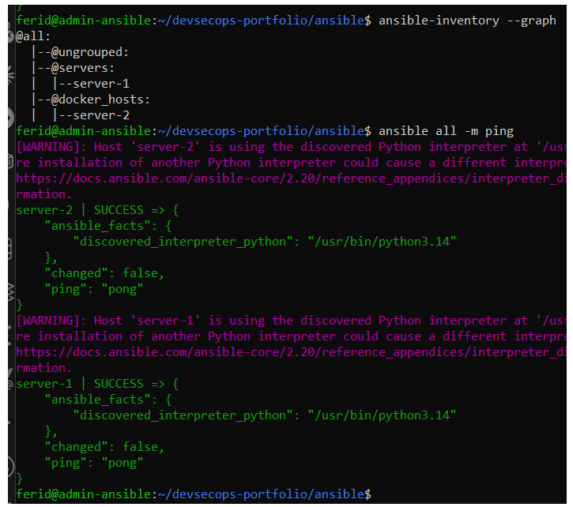
### Étape 27 : premier playbook, installation de packages

Playbook `ansible/install-packages.yml` :

```yaml
---
- name: Installer des packages de base
  hosts: all
  become: true

  tasks:
    - name: Mettre à jour le cache apt
      ansible.builtin.apt:
        update_cache: true
        cache_valid_time: 3600

    - name: Installer git, curl et tree
      ansible.builtin.apt:
        name:
          - git
          - curl
          - tree
        state: present
```

Exécution depuis la VM d'administration :

```bash
ansible-playbook install-packages.yml -K
```

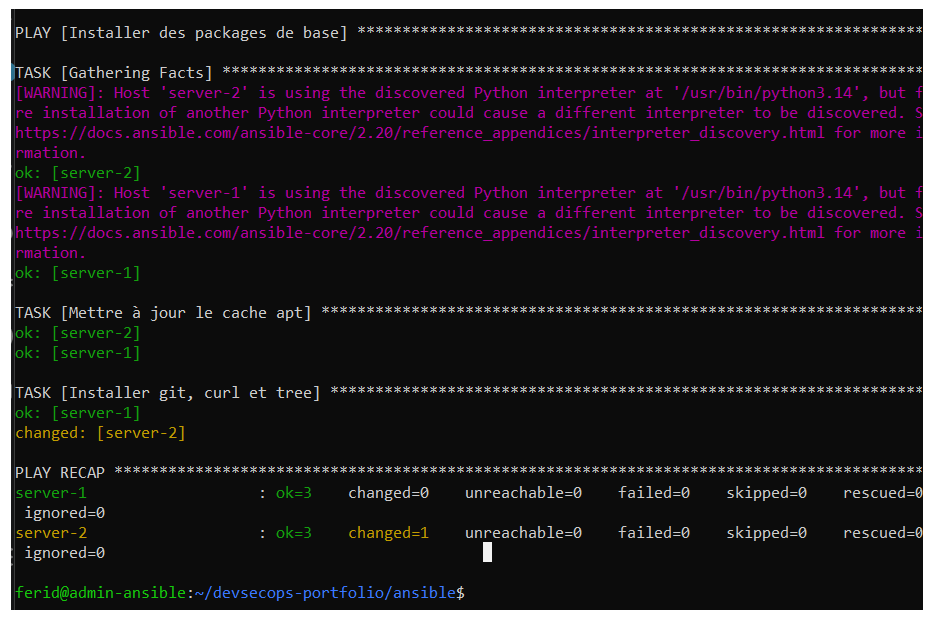

Un second lancement ne modifie rien (`changed=0`) : le playbook est idempotent.

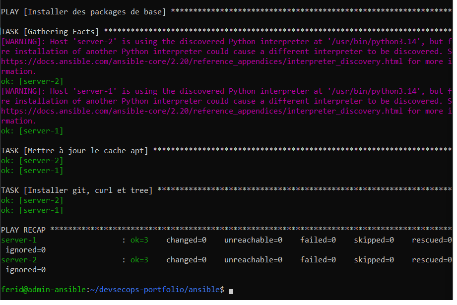
### Étape 28 : installation automatique de Docker

Playbook `ansible/install-docker.yml`, exécuté sur le groupe `docker_hosts` (une VM neuve sans Docker) :

```yaml
---
- name: Installer Docker
  hosts: docker_hosts
  become: true

  tasks:
    - name: Installer les prérequis
      ansible.builtin.apt:
        name:
          - ca-certificates
          - curl
        state: present
        update_cache: true

    - name: Créer le dossier des clés APT
      ansible.builtin.file:
        path: /etc/apt/keyrings
        state: directory
        mode: "0755"

    - name: Télécharger la clé GPG de Docker
      ansible.builtin.get_url:
        url: https://download.docker.com/linux/ubuntu/gpg
        dest: /etc/apt/keyrings/docker.asc
        mode: "0644"

    - name: Ajouter le dépôt Docker
      ansible.builtin.apt_repository:
        repo: "deb [arch=amd64 signed-by=/etc/apt/keyrings/docker.asc] https://download.docker.com/linux/ubuntu {{ ansible_distribution_release }} stable"
        filename: docker
        state: present

    - name: Installer Docker Engine
      ansible.builtin.apt:
        name:
          - docker-ce
          - docker-ce-cli
          - containerd.io
          - docker-buildx-plugin
          - docker-compose-plugin
        state: present
        update_cache: true

    - name: Démarrer et activer Docker
      ansible.builtin.service:
        name: docker
        state: started
        enabled: true

    - name: Autoriser l'utilisateur à utiliser Docker
      ansible.builtin.user:
        name: "{{ ansible_user }}"
        groups: docker
        append: true

    - name: Lire la version de Docker
      ansible.builtin.command: docker --version
      register: docker_version
      changed_when: false

    - name: Afficher la version de Docker
      ansible.builtin.debug:
        msg: "{{ docker_version.stdout }}"
```

Exécution depuis la VM d'administration :

```bash
ansible-playbook install-docker.yml
```

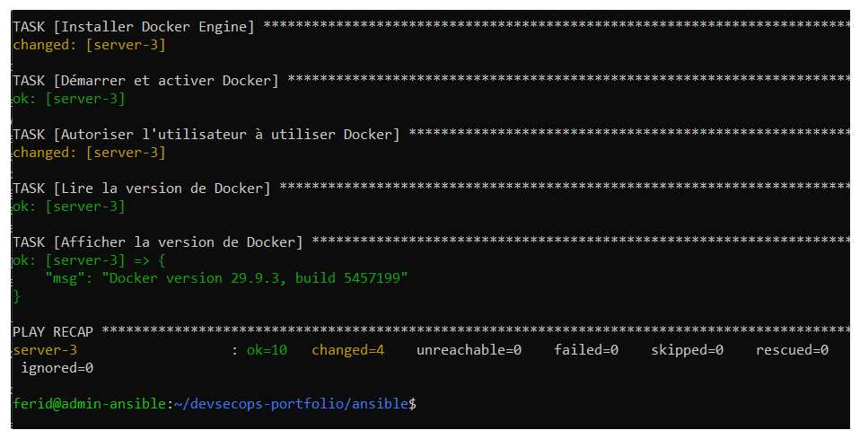

Résultat de `docker --version` sur la VM cible :

```bash
ansible docker_hosts -a "docker --version"
```

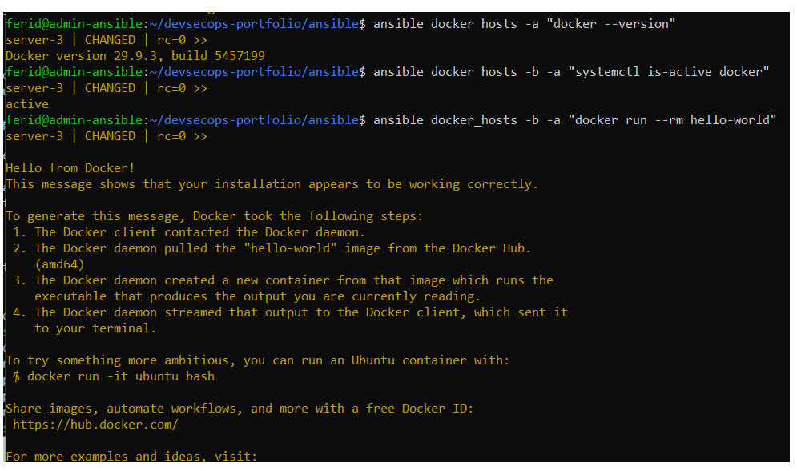

Installation de Docker à partir de playbook sur server-3

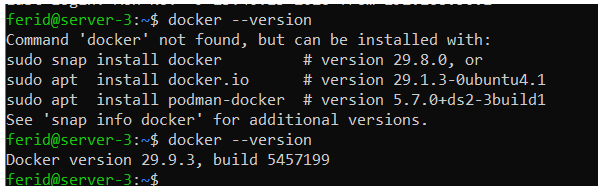


## VIII. API Node.js / Express

### Étape 29 : le dossier `api`

L'API est une application Node.js / Express indépendante du frontend, avec son propre `package.json`.

Structure du projet :

```
devsecops-portfolio/
├── api/
│   ├── package.json
│   ├── package-lock.json
│   └── server.js
├── app/
├── components/
├── data/
└── ...
```

Lancement de l'API seule :

```bash
cd api
npm install
npm start
```

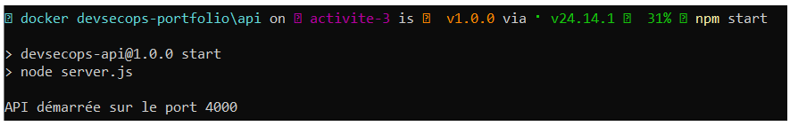et démarrage
### Étape 30 : route `GET /api/health`

Retourne l'état de l'API.

```js
app.get("/api/health", (req, res) => {
  res.json({
    status: "ok",
    message: "L'API fonctionne",
    uptime: Math.round(process.uptime()),
    timestamp: new Date().toISOString(),
  });
});
```

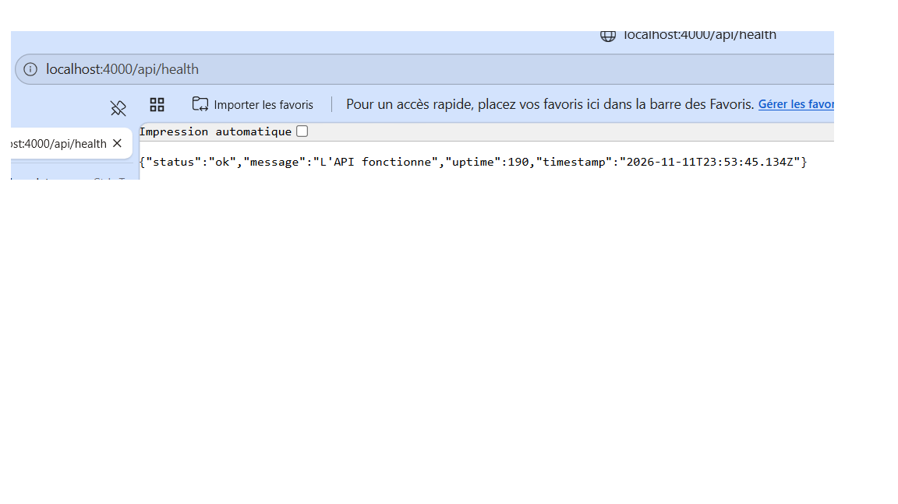

### Étape 31 : route `GET /api/profile`

Retourne les informations principales du Portfolio au format JSON (données dans `api/data/profile.js`).

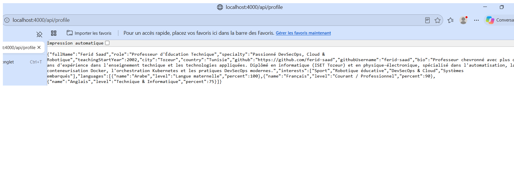

### Étape 32 : route `GET /api/projects`

Retourne la liste des projets (données dans `api/data/projects.js`).

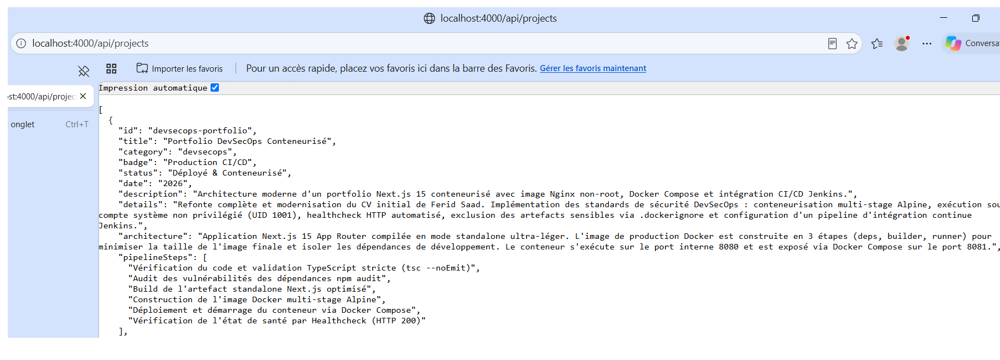

### Étape 33 : route `GET /api/skills`

Retourne la liste des compétences (données dans `api/data/skills.js`).

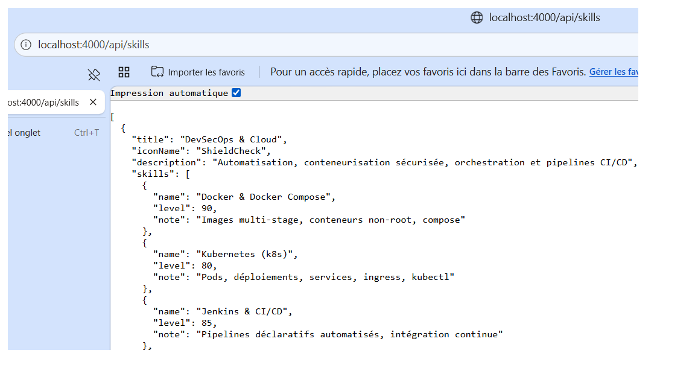

## Étape 34 : le frontend récupère les projets depuis l'API

La page d'accueil (`app/page.tsx`) est un composant serveur qui appelle l'API Express via `lib/api.ts`, puis transmet la liste des projets au composant client `HomeClient`. Si l'API est indisponible, le site utilise les données locales de `data/projects.ts` pour rester disponible.

```ts
const res = await fetch(`${API_URL}/api/projects`, { cache: 'no-store' });
```

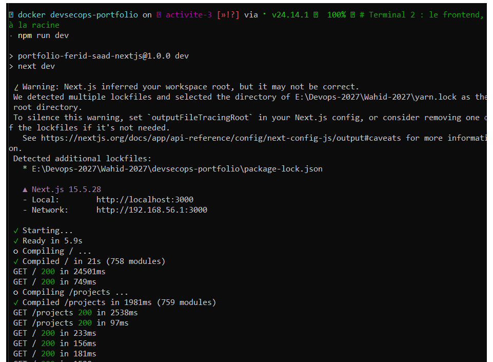

## Étape 35 : le frontend récupère les compétences depuis l'API

Comme pour les projets, la page d'accueil appelle `GET /api/skills` côté serveur (`getSkills()` dans `lib/api.ts`) et transmet la liste au composant `Skills`. Si l'API est indisponible, le site utilise `data/skills.ts`.

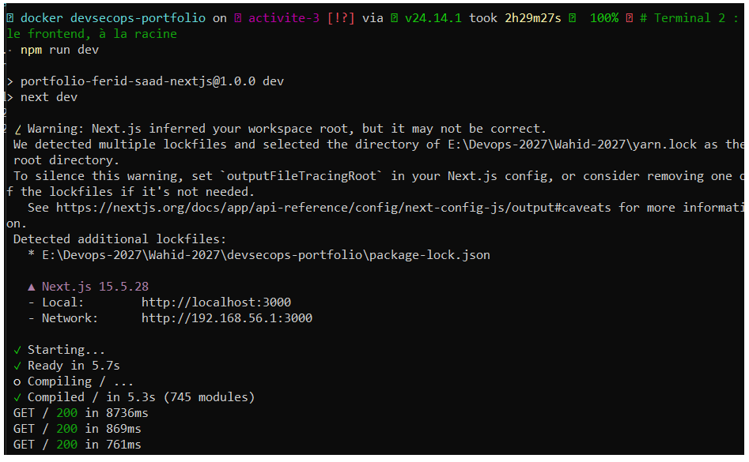

## IX. Variables d'environnement et configuration

### Étape 36 : variable `API_URL`

L'URL de l'API est lue dans la variable d'environnement `API_URL` (`lib/api.ts`), définie dans `.env.local` en développement :

```
API_URL=http://localhost:4000
```

**Pourquoi ne pas coder l'URL en dur ?**

- L'adresse change selon l'environnement : `http://localhost:4000` en local, `http://api:4000` dans Docker Compose, une autre adresse en production. Avec une variable, le même code et la même image Docker fonctionnent partout.
- On change la configuration sans modifier le code, sans recompiler et sans nouveau commit.
- La configuration est séparée du code source : les valeurs propres à une machine ou à un secret (clés, mots de passe) ne se retrouvent jamais dans le dépôt Git.
- Le principe est celui des applications « 12 factors », la norme des déploiements conteneurisés.

Si `API_URL` n'est pas défini ou que l'API est injoignable, le site utilise ses données locales et le signale dans les logs.

### Étape 37 : fichier `.env.example`

Le fichier `.env.example` liste les variables nécessaires, sans secret. Pour configurer son environnement :

```bash
cp .env.example .env.local
```

Contenu de `.env.example` :

```
# URL de l'API Express, lue côté serveur par Next.js
# En local : http://localhost:4000
# Dans Docker Compose : http://api:4000
API_URL=http://localhost:4000

# Port d'écoute de l'API Express (utilisé par api/server.js)
PORT=4000
```

Le fichier `.env.local`, qui contient la configuration réelle de chaque machine, n'est jamais versionné.

## X. Dockerisation
## X. Dockerisation frontend + API

### Étape 38 : Dockerfile du frontend

Image multi-stage (dépendances, compilation, exécution) basée sur `node:20-alpine`. Le mode `standalone` de Next.js limite l'image finale aux fichiers nécessaires, et le conteneur s'exécute avec l'utilisateur non privilégié `nextjs` (UID 1001).

```dockerfile
# ==========================================
# Multi-stage Dockerfile pour Next.js 15
# Portfolio DevSecOps - Ferid Saad
# Sécurité : non-root user, image Alpine légère
# ==========================================

# Étape 1 : Dépendances
FROM node:20-alpine AS deps
WORKDIR /app
RUN apk add --no-cache libc6-compat
COPY package.json package-lock.json* ./
RUN npm ci

# Étape 2 : Build de l'application Next.js
FROM node:20-alpine AS builder
WORKDIR /app
COPY --from=deps /app/node_modules ./node_modules
COPY . .
ENV NEXT_TELEMETRY_DISABLED=1
ENV NODE_ENV=production
RUN npm run build

# Étape 3 : Image de production finale (Runner minimal et sécurisé)
FROM node:20-alpine AS runner
WORKDIR /app

ENV NODE_ENV=production
ENV NEXT_TELEMETRY_DISABLED=1
ENV PORT=8080
ENV HOSTNAME="0.0.0.0"

# Sécurité : Création d'un groupe et d'un utilisateur non-root
RUN addgroup --system --gid 1001 nodejs && \
    adduser --system --uid 1001 nextjs

# Copie des fichiers publics et des artefacts standalone
COPY --from=builder /app/public ./public
COPY --from=builder --chown=nextjs:nodejs /app/.next/standalone ./
COPY --from=builder --chown=nextjs:nodejs /app/.next/static ./.next/static

# Bascule vers l'utilisateur non-root
USER nextjs

EXPOSE 8080

# Healthcheck Docker conforme aux exigences DevSecOps
HEALTHCHECK --interval=30s --timeout=5s --start-period=10s --retries=3 \
  CMD wget -qO- http://127.0.0.1:8080/projects > /dev/null || exit 1
  
CMD ["node", "server.js"]

```

### Étape 39 : Dockerfile de l'API

L'API est une application Node.js simple : seules les dépendances de production sont installées, l'application tourne sous l'utilisateur `node`, et un `HEALTHCHECK` interroge la route `/api/health`.

```dockerfile
FROM node:20-alpine
WORKDIR /app
ENV NODE_ENV=production
ENV PORT=4000

COPY package.json package-lock.json ./
RUN npm ci --omit=dev

COPY . .

USER node
EXPOSE 4000

HEALTHCHECK --interval=30s --timeout=3s --start-period=5s --retries=3 \
  CMD wget -qO- http://127.0.0.1:4000/api/health || exit 1

CMD ["node", "server.js"]
```

### Étape 40 : construction des images

```bash
docker build -t devsecops-portfolio .
docker build -t devsecops-api ./api
docker images --filter "reference=devsecops-*"
```

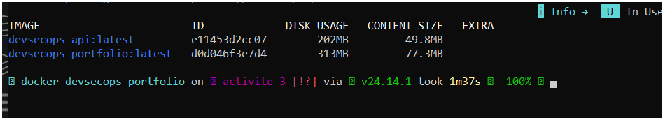

### Étape 41 : Docker Compose

Un seul fichier démarre les deux services, `api` et `frontend`, sur un réseau commun. Le frontend atteint l'API par son nom de service (`http://api:4000`), passé dans la variable `API_URL`, et ne démarre que lorsque l'API est `healthy`.

```yaml
services:
  api:
    build:
      context: ./api
    image: devsecops-api
    ports:
      - "127.0.0.1:4000:4000"
    restart: unless-stopped
    security_opt:
      - no-new-privileges:true

  frontend:
    build:
      context: .
    image: devsecops-portfolio
    ports:
      - "3000:8080"
    environment:
      - API_URL=http://api:4000
    depends_on:
      api:
        condition: service_healthy
    restart: unless-stopped
    security_opt:
      - no-new-privileges:true
```

Démarrage et état des services :

```bash
docker compose up -d --build
docker compose ps
```

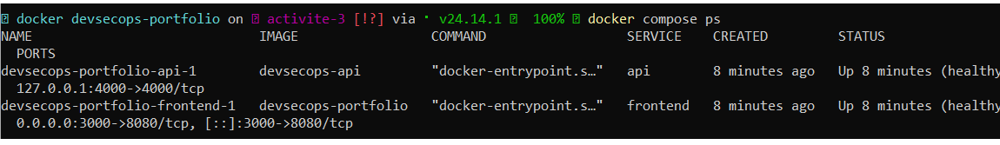

### Étape 42 : communication entre le frontend et l'API

Docker Compose crée un réseau commun aux deux services. Le conteneur `frontend` appelle l'API avec le nom du service (`API_URL=http://api:4000`), sans aucune adresse IP.

Vérification depuis le conteneur du frontend :

```bash
docker compose exec frontend printenv API_URL
docker compose exec frontend wget -qO- http://api:4000/api/health
docker compose logs --tail 10 api
```

Preuve que les données viennent de l'API : le titre d'un projet a été modifié dans `api/data/projects.js`, seule l'image de l'API a été reconstruite (`docker compose up -d --build api`), et le nouveau titre s'affiche dans le portfolio sans reconstruire le frontend.

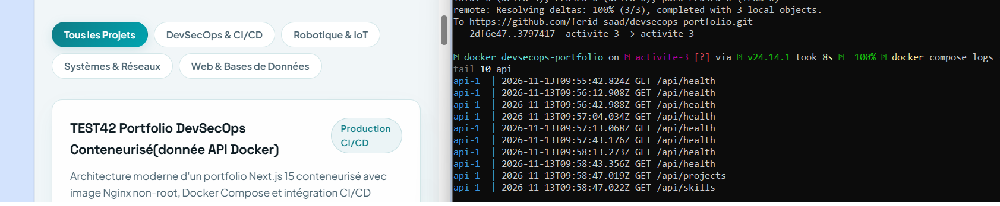

## 👤 Auteur

**Ferid Saad**
- 📧 Email : [fersd2018@gmail.com](mailto:fersd2018@gmail.com)
- 📞 Téléphone : [+216 97 460 346](tel:+21697460346)
- 📍 Localisation : Tozeur, Tunisie
- 🐙 GitHub : [github.com/ferid-saad](https://github.com/ferid-saad)